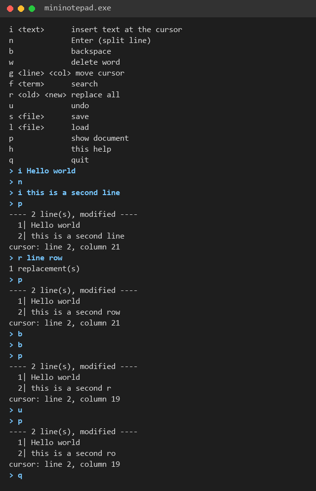

# Mini Notepad++ (C)

A small console text editor built on a doubly linked list of lines.

## Context

Coursework for the Programming Laboratory (Prolab) course, Computer Engineering, Kocaeli University - Spring 2026, project 1.

## Features

- Insert character, backspace, delete word, Enter (line split) and line merge
- Search and replace all
- Undo stack (256 steps)
- Load and save text files
- `editor.c` is the editor engine; `main.c` is a thin command loop on top of it

## Build and run

```
gcc main.c -o mininotepad
./mininotepad
```

Type `h` for the command list, for example:

```
i Hello world
n
i second line
p
u
p
```

## Screenshot

A short session (built with MSVC on Windows): insert two lines, replace a word, search (prints line and column of every match), two backspaces, one undo.



## Notes

No network access, no keys or credentials.

## Authors

- [Hani Ashrafi](https://github.com/H1ashrafi)
- [Hasan Hüseyin Yüksel](https://github.com/Hasan-Huseyin-Yuksel)

## License

Free for personal, educational and research use. **Commercial use (selling, publishing the app in a store, or using it in a paid product) is not allowed without written permission.** See `LICENSE` (PolyForm Noncommercial 1.0.0).
